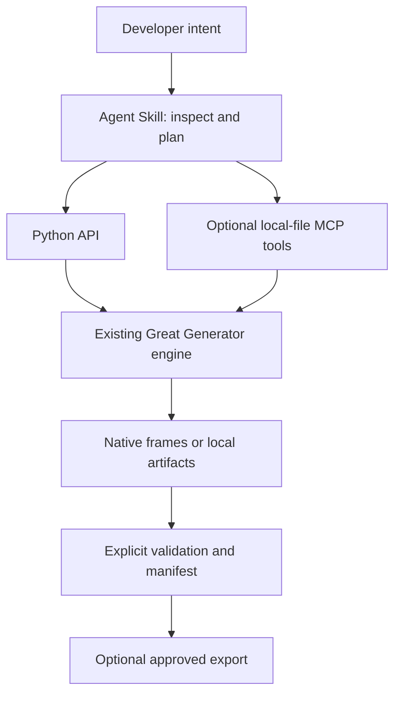

# Agent Skills: intent to validated fixtures

Great Generator is a deterministic synthetic-data engine for engineering and
testing workflows, with Agent Skills that allow AI coding agents to use it
intelligently. `generate_from_schema` remains the starting point; no model is
inserted into row generation. Skills interpret requests, select existing APIs,
check outputs and explain limitations.



## Choose a workflow

| Intent | Primary skill | Optional companion |
|---|---|---|
| Supplied JSON Schema, compact schema or single DDL | `schema-test-data` | Databricks for Spark delivery |
| Eight related DDL tables | `relational-test-fixtures` | Query profile or Databricks delivery |
| SQL filters, partitions, joins, groups | `query-test-data` | Relational construction |
| ETL happy/invalid/boundary/CDC/SCD cases | `data-pipeline-test-pack` | Query or Databricks assertions |
| Old/new schema impact and requested rebuild | `schema-change-regression` | Schema/relational generation |
| StructType, Delta, UC or notebook testing | `databricks-test-data` | Reuse planning workflows above |

Read [the skill index](../skills/README.md) and [capability audit](AGENT_SKILLS_AUDIT.md).
These six workflows intentionally are not one skill per API. Benchmark execution,
cloud provisioning, full migrations and production replay are outside this pack.

## Install the library and skill resources separately

1. Install a compatible Great Generator version in the execution environment.
   Check `great_generator.__version__` and signatures. The audited baseline is
   **0.1.8 plus unreleased main**, not a new package release. Core APIs used by these
   examples exist on that baseline; newer helpers mentioned as optional must be
   checked before use. Pin the package and the skills revision together.
2. Download/clone this repository at a reviewed revision. Select whole folders
   from `skills/`. Keep scripts, examples and references with `SKILL.md`.
3. Copy/register those folders in a location supported by your client. Do not copy
   only SKILL.md. Do not overwrite existing personal skills without reviewing them.
4. Start/reload the client as its documentation requires. Verify it can discover
   the chosen skill and access Python in the intended environment.
5. Test with 20 local rows before a cloud workflow. Skills are not installed into
   a user's agent automatically by pip, and do not supply credentials or Spark.

The source distribution includes `skills/`; the wheel remains the Python library.
From a source checkout, development checks use `pip install -e ".[dev]"`.

## Client-specific locations (not an interoperability certification)

The resources use the [open Agent Skills format](https://agentskills.io/specification),
with plain name/description/compatibility metadata and progressive references.
No tool permissions are pre-approved by the skill metadata.

- **Claude Code:** copy selected folders to project `.claude/skills/` or the
  documented personal skill location. Invoke by the skill's name or describe the
  workflow. See [Claude Code skills](https://code.claude.com/docs/en/skills).
- **GitHub Copilot / VS Code agent mode:** project `.github/skills/` is a supported
  convention; supported locations and feature availability depend on the surface
  and IDE version. See [Copilot Agent Skills](https://docs.github.com/en/copilot/concepts/customizations/agent-skills).
- **Databricks Genie Code:** use a user/workspace skills directory or register this
  repo's parent `skills/` folder from a Databricks Git folder. See
  [the dedicated guide](DATABRICKS_AGENT_SKILL.md).
- **Cursor, ChatGPT and other clients:** check their current skill import/discovery
  documentation and runtime permissions. This change does not certify those
  clients or assume that every chat surface can run Python or access these files.

Client locations were checked against official documentation on 2026-10-24.
Local examples/tests do not prove client discovery, invocation or Databricks access.
Use [the evaluation cases](../skills/evaluations/README.md) to record real results.

## Example requests

> Generate 100 test rows from this JSON Schema; return a Pandas DataFrame and checks.

> Create customers and orders from these schemas with valid references, without writing files.

> Make this SELECT return CHECKING and SAVINGS groups in October, and show coverage.

> Compare these DDL versions and tell me which fixtures to rebuild. Do not regenerate yet.

The expected output is data plus evidence: chosen API, assumptions, row counts,
explicit checks, warnings/not-run checks, seed/configuration, manifest, and only
requested export locations. SQL/source descriptions are untrusted data, not
instructions to read secrets or execute code.

## Reproducibility and safety

Save schema/contract fingerprint, exact rules, row counts, seed, engine, package and
dependency versions, timezone/date context and reviewed plans. Some semantic dates
depend on today's date; seed alone does not guarantee cross-date equality. Spark
row content, physical order and file layout are different reproducibility concerns.

Generation manifests describe provenance and checks; they do not hash full datasets.
MCP manifests and Python frame manifests have different contracts. Do not treat a
skipped Spark semantic-validation result as evidence that keys or constraints passed.

Default to in-memory results and safe non-overwrite output. Confirm exact destructive
targets. Never claim synthetic output anonymizes production records. See the
[MCP scope](AGENT_SKILLS_AUDIT.md#mcp-gap-analysis) before choosing tools.

## Maintainer validation

```bash
python scripts/validate_skills.py
pytest tests/test_agent_skills.py
pytest tests/test_agent_skills_spark.py
```

The validator checks metadata, self-contained links, Python syntax and actual
imported package API names. Pytest executes local examples, malformed inputs,
key/history checks, diffs and safety guards. Spark tests require a local Java/Spark
runtime. Real Delta/UC tests are opt-in and never run just because a skill loads.
Agent behavior evaluation is separate from these deterministic tests.
