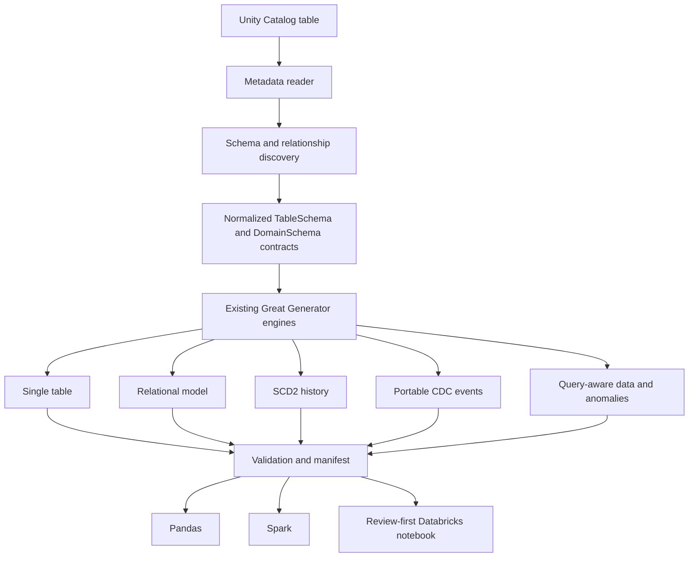

# Databricks Unity Catalog integration

Great Generator can use a fully qualified Unity Catalog table name as a **metadata source**. It reads permitted schema and constraint metadata, converts that metadata into Great Generator contracts, and delegates row generation to the existing Pandas or Spark engines.

It does not read production records during normal metadata discovery, does not write to source tables, and does not manage credentials.

## Install

The base package remains lightweight:

```bash
pip install great-generator
```

For local Databricks SDK access:

```bash
pip install "great-generator[databricks]"
```

PySpark is normally supplied by Databricks. For local Spark tests, use `great-generator[spark]`.

## Inspect permitted metadata

Inside a Databricks notebook:

```python
from great_generator import inspect_unity_catalog_table

snapshot = inspect_unity_catalog_table(
    "retail.sales.fact_orders",
    include_constraints=True,
    include_tags=True,
    include_relationships=True,
    include_related=True,
    related_direction="parents",
    max_depth=2,
    max_tables=20,
    spark=spark,
)

print(snapshot.fingerprint())
snapshot.save("/Volumes/synthetic_sandbox/metadata/fact_orders_schema.json")
```

Outside a notebook, provide `warehouse_id=...`. The optional SDK uses [Databricks unified authentication](https://docs.databricks.com/aws/en/dev-tools/auth/unified-auth); Great Generator does not implement a credential store.

## Generate one table

```python
from great_generator import generate_from_unity_catalog

df = generate_from_unity_catalog(
    "retail.sales.dim_customer",
    rows=100_000,
    output="spark",
    spark=spark,
)
```

Spark generation uses the existing distributed relational engine and `spark.range`; it does not collect generated rows into Pandas. Pandas output is available with `output="pandas"`.

## Metadata supported

| Metadata | Status | Notes |
|---|---|---|
| Catalog, schema, table, object type, source format, comment | Supported | Read from `INFORMATION_SCHEMA.TABLES` |
| Ordered columns, scalar SQL types, nullability, defaults, comments, partition positions | Supported | Read from `INFORMATION_SCHEMA.COLUMNS` |
| Table and column tags | Supported when visible | Tags are privilege-filtered; do not put secrets in tags |
| Primary, unique, and foreign keys, including composite keys | Supported | Read from constraint usage views |
| Related parent/child discovery | Supported | Conservative depth/table limits |
| Check expressions, identity/generated expressions, arbitrary properties | Preserved only when exposed | Not silently enforced when unavailable |
| `ARRAY`, `MAP`, `STRUCT`, `VARIANT` row generation | Not yet supported | Snapshot reports the original type; generation raises a clear error |

Databricks information-schema results are permission-filtered. Missing metadata can mean either “not declared” or “not visible.” PK/FK constraints are informational metadata, so Great Generator validates its generated output independently. See the Databricks documentation for [information schema](https://docs.databricks.com/aws/en/sql/language-manual/sql-ref-information-schema), [table constraints](https://docs.databricks.com/aws/en/tables/constraints), and [governed tags](https://docs.databricks.com/aws/en/database-objects/tags).

## Authentication and permissions

Supported paths:

- Active Databricks notebook SparkSession: pass `spark=spark`.
- Databricks SDK unified authentication: pass `warehouse_id=...`.
- Injected metadata clients for tests or controlled platform adapters.
- `StaticUnityCatalogClient` for offline examples and reviewed snapshots.

Typical inspection needs metadata visibility plus `USE CATALOG` and `USE SCHEMA` as governed by the workspace. Writes are separate and require permissions only on an explicitly approved synthetic target.

## Architecture



There is no second generator. Unity Catalog metadata is normalized into the same contracts used by existing Great Generator APIs.

## Current boundaries

- Cyclic and self-referencing FK graphs fail clearly; staged cycle resolution is not silently approximated.
- Automatic relationship discovery currently resolves within the source catalog. Cross-catalog models can use explicit fully qualified mappings and separately visible metadata.
- Composite PK/FK tuples are supported for declared relational generation and validation. Individual composite PK components may be more unique than the source contract requires.
- Automatic dimensional-role transformation is not inferred from `dim_`/`fact_` names. Use the relational graph or an explicit model contract.
- UC SCD2 reuses the existing Pandas history engine and currently supports one explicit natural key. Date-consistent fact-to-dimension lookup is not yet automated.
- UC CDC events are deterministic portable records generated from synthetic state; they are not represented as Delta Change Data Feed rows.
- Query-aware UC generation currently follows the core engine boundary: Pandas supports query-aware options; Spark support remains future work.
- Generation does not reproduce production distributions unless the user configures them. It does not claim production runtime equivalence.

## Offline example

Use [`examples/databricks/unity_catalog`](../examples/databricks/unity_catalog/README.md) with its metadata-only fixture. Unit tests require no Databricks credentials or network access.
