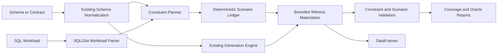

# Contract-to-Test architecture

## Decision

Add a testing/compiler layer, not another generation engine.



## Phase 1 modules

| Module | Responsibility |
|---|---|
| `testing/workload_parser.py` | Parse a documented SQL subset without executing SQL |
| `testing/query_contract.py` | Immutable workload, predicate, join, diagnostic, and scenario models |
| `testing/constraint_planner.py` | Resolve contract-compatible TRUE/FALSE/UNKNOWN and boundary witnesses |
| `testing/coverage_model.py` | Independent SQL three-valued evaluator for supported predicates |
| `testing/scenario_generator.py` | Place witnesses into distinct generated rows and enforce join paths |
| `testing/scenario_validator.py` | Measure row counts, keys, foreign keys, and actual witness outcomes |
| `testing/reports.py` | Coverage denominators, bounded expected assertions, static HTML |
| `testing/compiler.py` | Public orchestration and artifact export |

## Trust boundaries

- SQL is parsed as data and never executed by the compiler.
- Schema names, descriptions, SQL, and metadata are untrusted input.
- No production rows are required or read.
- The compiler does not send contracts to an external model.
- Negative cases are copied into separate labeled datasets.
- Exports reject non-empty targets unless the caller explicitly chooses overwrite.
- Reports exclude generated records by default.

## Determinism boundary

For the documented Pandas subset, generated rows and witness placement are deterministic from:

```text
normalized schema + SQL workload + requested coverage + row counts + realism + seed
```

The manifest timestamp and measured execution durations are intentionally not deterministic.
Pandas and future Spark-native outputs are not promised to be byte-identical.

## Phase gates

1. **Phase 1:** Pandas, acyclic simple relations, supported predicates, measured reports.
2. **Phase 2:** generic composite-key execution, bridge/cardinality profiles, staged cycles.
3. **Phase 3:** Spark-native witnesses and unified temporal state.
4. **Phase 4:** direct Unity Catalog snapshot-to-workload compilation.
5. **Phase 5:** broader mutation corpus and reproducible platform evaluation.

Unsupported structures must remain diagnostics or clear exceptions until their gate is met.
